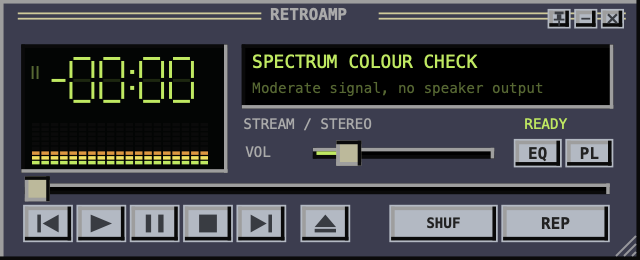
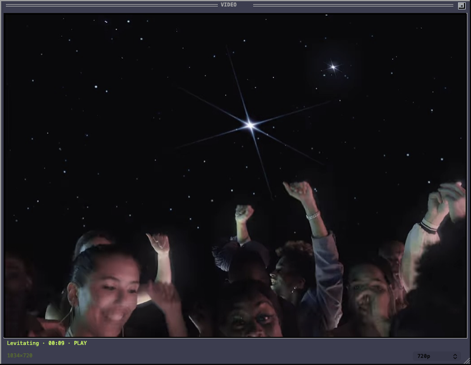
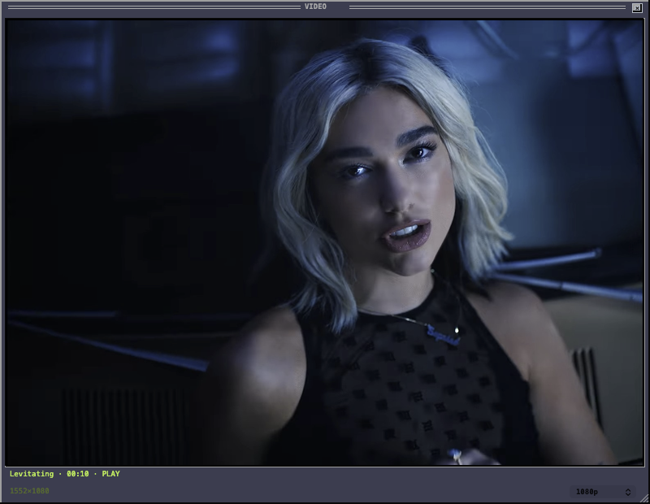

# Retroamp

A compact macOS music player with a Winamp 2-inspired interface. Plays local files and connects to your YouTube Music library.



**Experimental, version 0.10.0.** The interface is currently mostly Ukrainian. YouTube playback now uses an app-owned WebKit helper and native Core Audio EQ/FFT; Chrome is not kept running for playback.

### VIDEO in HD

Choose **AUTO**, **720p** or **1080p** in the VIDEO window. The line beside the selector shows the **decoded stream resolution**, so it also shows when YouTube has not supplied the requested quality. These are native window captures of the same public clip at both resolutions, with test audio muted.





The clip's aspect ratio determines its width; 1080p does not always mean 1920×1080. Frame delivery preserves up to 1920×1080 pixels without upscaling the source. Network buffering can delay a quality change; a selection made while paused is applied on resume to preserve the paused position.

## Features

- Three separate windows: player, equalizer, playlist. Drag the player header to move attached panels, including a chain of attached panels. Detached panels stay independent. Panel edges snap when dragged close together; each window can be resized separately.
- Clicking a panel brings the visible group forward. The small pin button keeps the windows on top.
- Optional VIDEO window for the current YouTube Music track, with independent movement/resizing and edge docking. It displays the existing media stream, so play/pause/seek stay synchronized and no second audio player is started. For an audio song, it asks YouTube Music for its explicitly paired music video and switches the same player to that recording, preserving position using the service's segment map when supplied. Hide it to stop video-frame delivery while music continues.
- Ten-band EQ, preamp, presets and an FFT spectrum from the audio signal.
- Click the clock to switch elapsed/remaining time. Click the spectrum to switch narrow/wide bars. Long titles scroll in the player.
- Local playback through AVAudioEngine. WAV, MP3, AAC/M4A, FLAC and AIFF have been tested.
- Add folders with nested albums. Imported tracks remain in the local library between launches; repeated imports do not duplicate tracks.
- The `+` button adds the current track to favorites: local favorites stay in Retroamp, and YouTube Music tracks are liked in the connected account after the service confirms the request.
- macOS Now Playing and media commands for play/pause, next/previous and seeking, without an Accessibility permission requirement.
- Focused-player shortcuts: Z previous, X play, C pause/resume, V stop, B next. After three seconds, Previous rewinds the current track; another press at the beginning selects the preceding track. Typing in search fields or sheets is unaffected.
- Lit state indicators for playback, EQ processing, panel visibility, shuffle and repeat. Shuffle can be disabled to restore the original queue order; repeat-one displays `REP1` in the default skin.
- Visualizer settings for sensitivity, display range, decay and 15/24/30 frames per second. They affect the display only.
- Classic rectangular Winamp 2 `.wsz` skins. Original Winamp skins are not bundled.
- Google sign-in and access to your YouTube Music library, without manually copying request headers.

See [the changelog](CHANGELOG.md) for changes since the published 0.8 source.

## Resource use

WebKit runs in a separate, app-owned helper. A private Core Audio process tap selects only its verified GPU audio process, suppresses direct output, and feeds bounded PCM buffers into the native equalizer and spectrum. Chrome is no longer a playback dependency. Local files continue to use AVAudioEngine.

The spectrum uses a persistent FFT setup, a reusable analysis buffer and bounded audio queues. The player redraws only changing regions; VIDEO frame delivery is serialized, capped at about 15 polling cycles per second and releases its canvas when hidden. Its readback canvas uses software backing where WebKit supports it, avoiding an unnecessary GPU/readback buffer pool. Native idle animation sleeps, and paused playback uses slower state checks.

Memory and CPU measurements, including attribution limits and the earlier Chrome baseline, are recorded in [the validation notes](docs/VALIDATION.md). These are short local samples, not a guarantee for every account, clip, macOS version or display configuration.

## Build

Requires macOS 14.2 or later and Xcode 26 or later (or equivalent Command Line Tools with a macOS 26 SDK). Local runtime testing has been on Apple Silicon. YouTube streaming uses built-in WebKit and Core Audio. The existing Google sign-in flow still opens Chrome briefly in a dedicated temporary profile; Chrome is required only for a new Google sign-in, not playback, saved-session restoration or local files.

```sh
git clone https://github.com/namewithin/retroamp.git
cd retroamp
./build.sh
```

The script builds for the host architecture and creates `dist/Retroamp-0.10.0.dmg`. Swift is compiled with `-O -whole-module-optimization`. It uses the macOS frameworks and system zlib; no package manager or API key is required. Set `RETROAMP_OUTPUT_DIR` to choose another output directory. For a local app-only build, set `RETROAMP_APP_DIR=/private/tmp/retroamp-build RETROAMP_SKIP_DMG=1`. The helper is embedded, signed and verified against its build-time SHA-256 before launch.

GitHub Actions builds the host-architecture app and runs isolated, silent regressions on Apple Silicon and Intel macOS runners: 16 native-DSP assertions, 13 synthetic session assertions and 40 local-library/media-command/visualizer/window assertions. Checks run whenever a PR opens, is reopened or receives a new commit, and on pushes to `main`. Logs, JSON results and synthetic UI renders are uploaded as artifacts. It does not test a Google account or system-audio capture. To run that check locally, see [validation notes](docs/VALIDATION.md#reproducing-the-offline-dsp-check).

The build is ad-hoc signed. Developer ID signing, notarization and automatic updates are not configured. If macOS blocks a locally built app, use the normal macOS approval flow after reviewing the code.

## Use

- **Local music:** press ⌘O or the eject button to add files or folders; ⌘⇧O selects folders only. Dropping folders onto the player or playlist also imports nested albums. The file picker adds tracks without starting playback. Double-click a playlist entry to play it. LIB → “Локальні файли” returns to the saved local library. Space pauses/resumes when you are not editing text. Initial volume is 15%.
- **Favorites:** `+` saves the current track. LIB → “Улюблені Retroamp” shows saved favorites; YouTube Music tracks are also added to the account's liked songs. “Завантажити ще” in LIB or the File menu loads another page of YouTube results.
- **Windows and display:** ⌘1/⌘2/⌘3 focuses the player/EQ/playlist. VID or ⌘4 opens VIDEO; × hides it without stopping music. Drag its header or resize its lower corner. Click the picture to pause/resume; focused transport shortcuts also work there. Choose AUTO / 720p / 1080p below the picture; the adjacent text shows actual decoded dimensions or unavailable quality. Opening VIDEO for an audio song looks up its official counterpart. A paired clip uses its own soundtrack and duration in the same player; no second soundtrack is mixed in. Closing VIDEO leaves that recording playing. Without a service-provided pair, the audio continues; unrelated search results are never substituted. A blocked clip returns to the audio version. Retroamp → “Налаштування…” (⌘,) opens visualizer settings.
- **YouTube Music:** click GOOGLE, then “Увійти через Google”. Complete sign-in and any MFA in the browser window; the app validates the session and loads the library. Saved sessions are restored on launch. After an ad-hoc update, use “Відновити збережений вхід” if macOS requires renewed Keychain access; this restores the saved session without opening Google. LIB opens library sections.
- **Skins:** use “Вигляд → Завантажити скін Winamp 2…”, or drop a `.wsz` file. “Основний скін Retroamp” restores the built-in look. “Зібрати вікна” restores the compact arrangement.

## How YouTube Music works

This is an **unofficial integration**, not the official Google OAuth API. Sign-in opens a separate temporary Chrome profile. The app captures the YouTube session, stores it in macOS Keychain and imports only YouTube cookies into its own temporary WebKit store. The Keychain item and native service API are unchanged by this migration. It does not read your regular Chrome or Safari profiles. No browser extension is required.

On first streamed playback, macOS may request **System Audio Recording** access. Despite the broad system label, Retroamp selects only its own verified WebKit GPU process; it does not select other apps, the microphone or a screen stream. The original helper output stays at or below 1%, with native gain compensation before EQ, so an interrupted host cannot leave a loud direct browser stream.

Ads and subscription restrictions remain in effect. Google changes can break sign-in, library requests or playback. Ad-hoc updates can require authorizing the new build's Keychain access in macOS; saved sessions are not tied to an executable hash. If Google expires or revokes a session, sign in again. No browser extension is required. Do not include cookies, session headers or account screenshots in bug reports.

## Limits and verification

Exact WebKit GPU identification currently uses a read-only WebKit SPI. Playback fails safely when that property is unavailable; this is not an App Store-ready architecture. Output-device switching and long-duration capture-clock drift still need broader testing.

Modern `.wal`/XML skins, arbitrary region masks, custom cursors and shade mode are not implemented. Google library access and playback can vary with account state and ads. Broader testing of macOS window behavior is welcome.

See [validation notes](docs/VALIDATION.md) for the exact local test scope and remaining manual checks. Media-key delivery depends on macOS selecting Retroamp as the current Now Playing app.

## License and credits

[MIT](LICENSE), copyright 2026 namewithin. See [NOTICE.md](NOTICE.md) for third-party attribution.

Classic sprite coordinates were checked against [Webamp](https://github.com/captbaritone/webamp), which is MIT licensed. Its notice is preserved. The default interface and app icon are drawn assets from this project. Imported skins retain their own licenses; the project's MIT license does not grant rights to Winamp artwork or branding. Retroamp is not affiliated with Winamp or Google.
